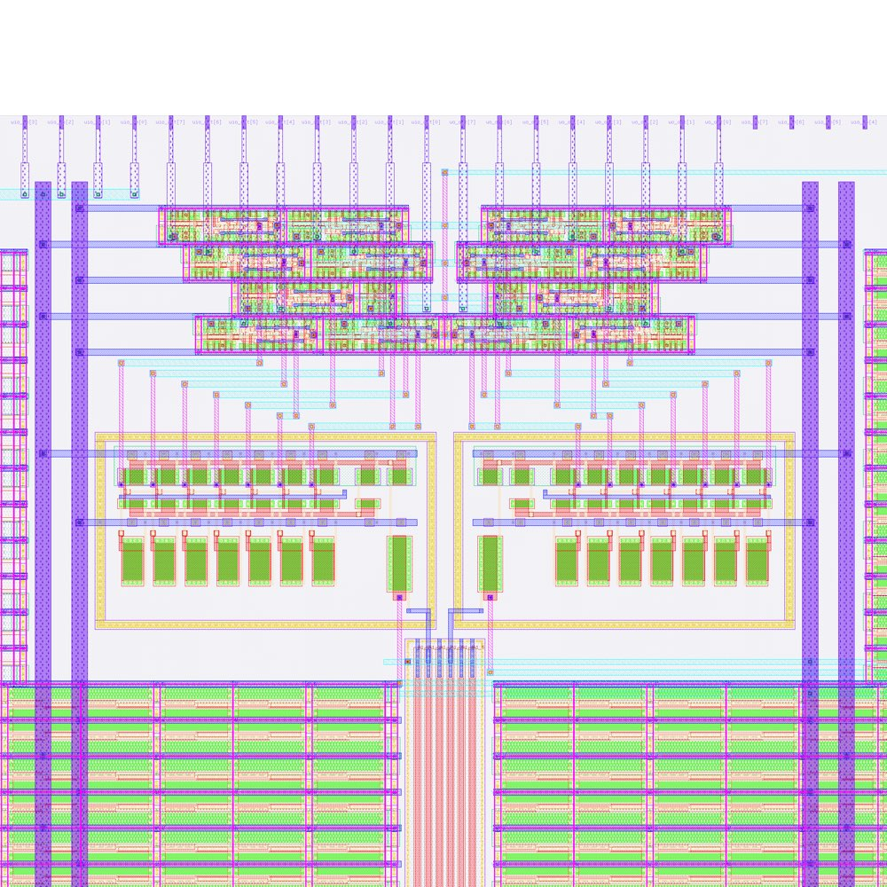

## How it works

This tile is a **pseudo-differential VCO-based delta-sigma ADC**: two identical ring-oscillator ADC halves, one driven by VINP and one by VINN, whose digital outputs are subtracted off-chip. Subtracting cancels the even-order distortion of the single-ended voltage-to-frequency curve, which is what limits a single open-loop VCO ADC.

**Analog front end (hand-drawn, sky130A 1.8 V devices), one per half**

- The input (`ua[0]` = VINP for the P half, `ua[1]` = VINN for the N half) drives the gate of M1 (W/L = 4/1). Its source sits on a 351 kΩ xhigh-poly resistor, so the control current is about (VIN − V_GS)/351 kΩ, roughly 1 µA to 4 µA.
- The resistors of both halves are one common-centroid array (strips D N P P N D) on the symmetry axis, so the two V-to-I gains track.
- A PMOS/NMOS mirror copies the current into a **7-stage current-starved ring oscillator** with a 1.4 µm × 2.86 µm NMOS load capacitor per stage (stage pitch 2.4 µm), inside a p-tap guard ring.
- The two halves are mirror images about the tile centre line. The input pair runs as parallel met3 lines with VGND shields on both sides.

**Digital back end (sky130_fd_sc_hd), one per half**

- 7 flip-flops (`dfxtp_4`) sample the 7 ring stage outputs on every rising edge of `clk`. A buffer brings out ring stage 0 unsampled as a frequency monitor.
- P half: `uo_out[6:0]` are the sampled phases, `uo_out[7]` is the monitor.
- N half: `uio_out[7:1]` are the sampled phases, `uio_out[0]` is the monitor (`uio_oe` is tied high, so all `uio` pins are outputs).
- Each flip-flop output drops straight up to its own pin; the pinout lists which ring stage sits on which pin. The decoding below does not depend on the bit order.

**Turning the phases into ADC codes (off-chip)**

For each half, XOR each 7-bit phase word with the previous one and count the ones:

`yP[n] = popcount(PHP[n] xor PHP[n-1])`, `yN[n]` likewise, and `y[n] = yP[n] − yN[n]`.

Each `y` counts the stage transitions in one clock period, 14·f_vco/fs, with first-order shaped quantization noise. Low-pass filtering and decimating `y` gives the ADC output.

The decoding needs **f_vco < fs/2** in each half (each stage may toggle at most once per clock). With fs = 10 MHz this holds for inputs between 0.7 V and 1.4 V at all simulated MOS corners. The resistor process spread can shift the curve by about 20%, so if a code ever reaches 7, raise fs (up to about 25 MHz) or lower the input common mode.

## How to test

Required: a differential source for `ua[0]`/`ua[1]` around 1.0 V, and a way to capture `uo_out[7:0]` and `uio[7:0]` continuously at fs.

1. Select the project and give it a 10 MHz clock. Reset and `ui_in` are not used.
2. **Open-loop VCO check:** apply equal DC voltages from 0.7 V to 1.4 V on both inputs and measure the frequency on `uo_out[7]` and `uio[0]`. This gives the tuning curve of each half and their matching.
3. **ADC check:** apply VINP = 1.0 V + A·sin, VINN = 1.0 V − A·sin with A = 0.1 V to 0.15 V and 1 kHz to 20 kHz. Capture all 16 outputs at every clock edge without gaps, for example with the RP2350 PIO and DMA (`test/capture_vco_adc.py` makes the clock and samples GPIO 25..40 in one state machine). Then run `test/decode_vco_adc.py` to get f_vco of each half, the spectrum and the SNDR of P alone and of P − N.

## External hardware

- A differential signal source or a DAC with two op-amp buffers for `ua[0]` and `ua[1]` (0.7 V to 1.4 V, low output impedance).
- Optional: a frequency counter or scope on `uo_out[7]` and `uio[0]`.
